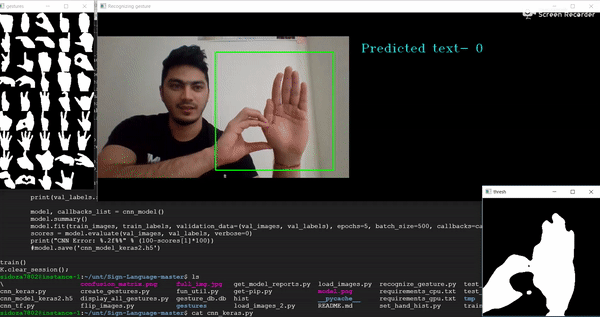

# Sign Language Recognition System

A real-time Sign Language recognition system. It reads a live webcam feed, isolates the hand, and uses a Convolutional Neural Network (CNN) to predict the sign being shown.

Built as a college project at NIT Hamirpur.

## Motivation

Many deaf and hard-of-hearing people depend on interpreters for everyday communication. This project explores how a low-cost, webcam-based system can recognize signs and display them as text.

## How it works

1. **Hand segmentation:** a hand histogram (`set_hand_histogram.py`) is used to separate the hand from the background.
2. **Dataset creation:** `create_gestures.py` captures labelled gesture images from the webcam.
3. **Augmentation:** `Rotate_images.py` flips the images to add variety.
4. **Dataset split:** `load_images.py` splits the images into training, validation and test sets.
5. **Training:** `cnn_model_train.py` trains a CNN (Conv2D + MaxPooling layers, dense layer, dropout, softmax) with Keras.
6. **Live recognition:** `final.py` runs the webcam loop and shows the predicted sign.

## Tech stack

- Python
- TensorFlow / Keras
- OpenCV
- NumPy

## Project structure

```
.
├── Code/
│   ├── set_hand_histogram.py
│   ├── create_gestures.py
│   ├── Rotate_images.py
│   ├── load_images.py
│   ├── display_gestures.py
│   ├── cnn_model_train.py
│   ├── final.py
│   ├── hist
│   ├── gesture_db.db
│   └── Install_Packages.txt
├── img/            # demo images and screenshots
├── LICENSE
└── README.md
```

## Setup

```bash
git clone https://github.com/Atul-Koundal/sign-language-recognition.git
cd sign-language-recognition
python3 -m venv venv
source venv/bin/activate
pip install -r Code/Install_Packages.txt
```

## Usage

Run these from inside the `Code/` folder:

```bash
python set_hand_histogram.py   # calibrate the hand histogram (or use the included `hist` file)
python create_gestures.py      # capture and label gesture images
python Rotate_images.py        # augment the images
python load_images.py          # split into train / validation / test sets
python display_gestures.py     # (optional) view the captured gestures
python cnn_model_train.py      # train the model
python final.py                # start live recognition
```

## Demo



## Results

The original authors report over 95% accuracy on 44 ASL characters. My own results will be added here after training and evaluation.

## My changes

- [ ] Update the code for current TensorFlow / Keras versions
- [ ] Record my own gesture dataset
- [ ] Add evaluation (test accuracy, confusion matrix)
- [ ] Add new features or improvements

## Limitations

- Accuracy depends on lighting, background and camera quality.
- It recognizes static signs only, not full continuous sign language.
- It covers a limited vocabulary.

## License

MIT. See [LICENSE](LICENSE).

Gesture images and labels come from the original author's release:
EvilPort2/Sign-Language 1.0, https://zenodo.org/records/1244279
